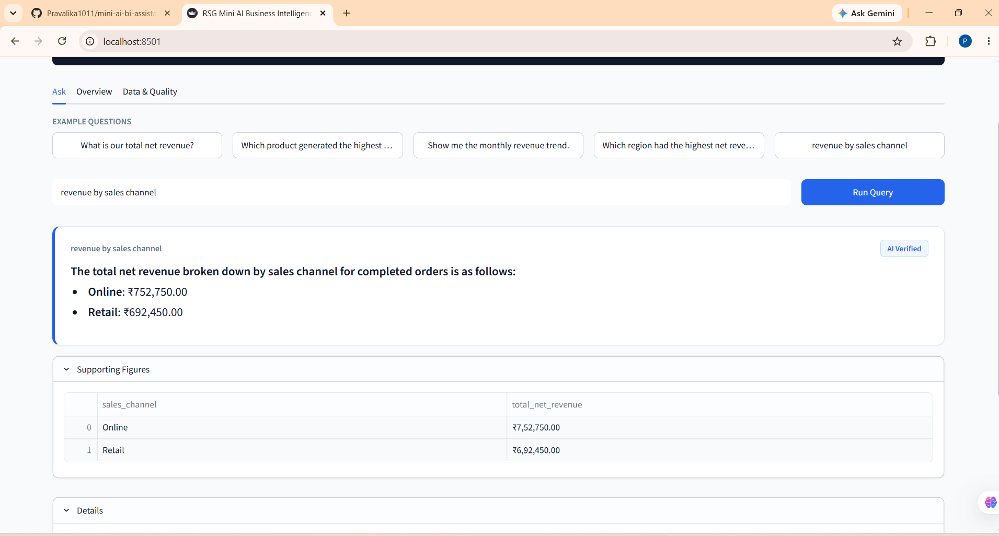
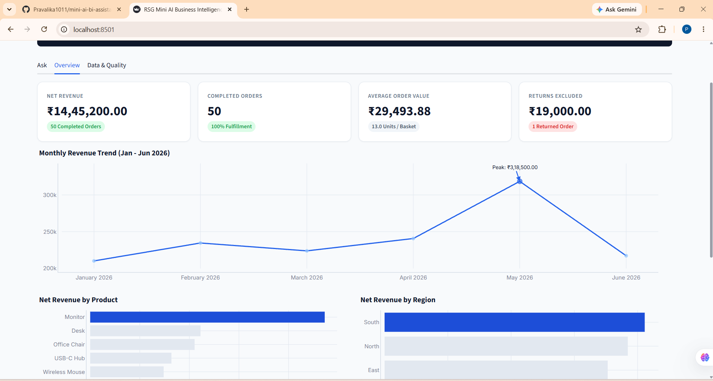

# RSG Mini AI Business Intelligence Assistant

An AI-powered Business Intelligence web assistant delivering verified, deterministic sales analytics and grounded natural language query processing over company transaction data. Built with **Python 3.11**, **FastAPI**, **SQLite**, **Streamlit**, and **Plotly**, with optional **Google Gemini** integration.

> **Note on Currency**: The underlying sales dataset CSV defines monetary amounts as numeric values without an explicit currency field. By default, the application formats monetary values using the Indian numbering system and the Indian Rupee symbol (**₹**, e.g., `₹14,45,200.00`), configurable via the `CURRENCY_SYMBOL` environment variable.

---

## 📸 Dashboard Screenshots

### 1. Interactive Natural Language Query ("Ask" View)


### 2. Executive Overview & Variance Analysis


---

## 🌟 What It Does

1. **Deterministic Analytics**: Ingests and cleans sales transaction records into SQLite, executing mathematically verified SQL aggregations without numerical hallucination.
2. **Natural Language Query Interface**: Stakeholders ask open-ended business inquiries (e.g., *"What is our total net revenue?"*, *"Which product sold the most in the East region?"*, *"Jan vs Mar"*).
3. **Dual Execution Engine**:
   - **Offline Rule-Based Scored Matcher**: Operates 100% offline with zero external API dependencies or costs.
   - **Google Gemini Tool-Calling Agent**: When configured with `GEMINI_API_KEY`, dispatches to analytical tools and guarded SQL with post-generation numerical grounding checks.
4. **Vectorless Semantic Retrieval**: Uses BM25 keyword scoring over `docs/metrics_glossary.md` to augment the agent context with formal metric definitions and RapidFuzz for fuzzy catalog entity normalization.
5. **Interactive Executive Visualizations**: Plotly charts adhering to a clean, minimal, publication-ready design system (white background, single blue accent, green/red variance indicators).

---

## 🏗️ Architecture Overview

The assistant follows a decoupled, three-tier architecture ensuring deterministic mathematical precision:

```
┌────────────────────────────────────────────────────────┐
│                   Streamlit Frontend                   │
│          (frontend/streamlit_app.py - Ask/Overview)    │
└───────────────────────────┬────────────────────────────┘
                            │ HTTP REST / JSON
┌───────────────────────────▼────────────────────────────┐
│                    FastAPI Backend                     │
│               (app/api.py - Port 8000)                 │
├───────────────────────────┬────────────────────────────┤
│   LLM Agent / Scored NLP  │   SQL Guard & Authorizer   │
│   (app/llm_agent.py)      │   (app/sql_guard.py)       │
│   - RapidFuzz Normalizer  │   - Read-Only SQLite URI   │
│   - BM25 Semantic Glossary│   - Token Whitelist        │
│   - Tool Calling Dispatch │   - Authorizer Callback    │
├───────────────────────────┴────────────────────────────┤
│              Deterministic Analytics Engine            │
│                 (app/analytics.py SQL)                 │
│         - Total Net Revenue: ₹14,45,200.00             │
│         - Top Product: Monitor (₹4,73,000.00)          │
│         - Top Region: South (₹4,11,200.00)             │
│         - Peak Month: May 2026 (₹3,18,500.00)          │
├────────────────────────────────────────────────────────┤
│                   Cleaned SQLite DB                    │
│                 (app/database.py)                      │
│        - `transactions` & `data_cleaning_audit`        │
└────────────────────────────────────────────────────────┘
```

---

## ⚖️ LLM vs. Deterministic: Honest Architectural Division

| Dimension | LLM Agent (Gemini 3.1 Flash Lite) | Deterministic Engine (SQLite / Python) |
|---|---|---|
| **Role** | Intent classification, parameter extraction, contextual narrative synthesis. | Arithmetic operations, filtering, grouping, date sorting, and sums. |
| **Hallucination Risk** | Mitigated via function calling and automated numerical post-validation. | **Zero**. Computations are standard SQL. |
| **Offline Operation** | Requires active internet connection and valid Gemini API key. | **100% Offline**, zero network dependencies. |
| **Security** | Untrusted freeform SQL blocked by multi-layer AST and authorizer guardrails. | Pre-parameterized queries and strict schema whitelist. |

### How Unsupported or Incorrect Answers Are Prevented:
1. **Tool-Grounded Execution**: The LLM is never asked to calculate figures in its neural weights. It calls predefined tools (`get_total_net_revenue`, `compare_monthly_revenue`, etc.) or passes through `run_sql`.
2. **SQL Guardrails**: `app/sql_guard.py` enforces:
   - Exactly one statement, rejecting semicolons, comments (`--`, `/* */`), and destructive statements (`DROP`, `DELETE`, `UPDATE`, `INSERT`, `PRAGMA`, `ATTACH`).
   - SQLite opened via read-only URI (`mode=ro`).
   - Active connection authorizer callback (`sqlite_read_only_authorizer`) denying any write or access to system tables.
   - Forced `LIMIT <= 200` and query timeouts (via `conn.set_progress_handler`).
3. **Grounding Post-Check**: Before returning a response, the agent parses all numeric values in the narrative and verifies that each exists within the tool results payload. If any unauthorized number is detected, the narrative falls back to a deterministic template.
4. **Clarification for Ambiguity**: Incomplete comparison questions like *"how did revenue change between two months"* trigger a `needs_clarification` status rather than guessing.
5. **Transparent Fallback Reason**: If the LLM call fails or cannot proceed (e.g., `no_api_key`, `http_429`, schema issues, timeouts), the system falls back to the deterministic engine while propagating a sanitized `fallback_reason` (e.g. in the response payload and the UI's "Details" expander), ensuring no silent or opaque failures.

---

## 🔍 Semantic Layer: Vectorless Retrieval over Metrics Glossary

Rather than deploying complex, opaque vector databases (full RAG), this application implements **vectorless semantic retrieval over a metrics glossary**:
1. **Metrics Glossary** (`docs/metrics_glossary.md`): Documents accounting definitions for Net Revenue, Gross Revenue, Returned Orders, AOV, Units, Discounts, Regional breakdowns, and data cleaning policies.
2. **In-House Okapi BM25 Retriever**: Tokenizes and stems the user inquiry, scoring it against glossary entries. The top 3 relevant glossary definitions are dynamically injected into the LLM system prompt.
3. **RapidFuzz Normalization**: Misspelled entities (e.g., *"wireles mouse"* or *"lap top stand"*) are fuzzy matched against catalog tables and normalized before query processing or SQL execution.

---

## 📊 Verified Business Intelligence Metrics

All figures below are independently recomputed and verified directly from the dataset:

| Metric | Verified Value | Calculation & Accounting Policy Notes |
|---|---|---|
| **Total Net Revenue** | **₹14,45,200.00** | 50 completed transactions. Gross: ₹14,49,700.00; Discounts: ₹4,500.00. |
| **Top Product** | **Monitor** (₹4,73,000.00) | 50 units sold across completed orders (32.73% of portfolio net sales). |
| **Top Region** | **South** (₹4,11,200.00) | Followed by North (₹3,84,450.00), East (₹3,52,700.00), and West (₹2,96,850.00). |
| **Monthly Trend** | Jan: ₹2,10,250<br>Feb: ₹2,34,600<br>Mar: ₹2,23,900<br>Apr: ₹2,40,700<br>May: ₹3,18,500 (Peak)<br>Jun: ₹2,17,250 | 6 consecutive months (Jan–Jun 2026). May is peak month. Chronological sum = ₹14,45,200.00. |
| **Month Comparison** | **+₹13,650.00 (+6.49%)** | Comparing January 2026 (₹2,10,250.00) to March 2026 (₹2,23,900.00). |
| **Order Performance (AOV)** | **₹29,493.88** | 49 qualifying orders (excluding zero-quantity TXN0034). Average 3.5 units/order. |
| **Returns Excluded** | **₹19,000.00** | TXN0033 (2 Monitor units, West) excluded from net sales per revenue standards. |
| **Imputed Unit Price** | **₹1,200.00** | TXN0051 (Laptop Stand, 5 units) imputed with invariant catalog mode. Recovered ₹6,000.00. |

---

## 📁 Project Structure & File Guide

Every file in the repository serves a specific architectural role:

```
IB/
├── .env.example                 # Configuration template for Gemini API key, model, and currency
├── .gitignore                   # Excludes virtual environments (.venv), caches, and SQLite databases
├── pytest.ini                   # Pytest test configuration and path resolution
├── requirements.txt             # Project Python dependencies
├── run.py                       # Concurrent process runner (FastAPI + Streamlit)
├── README.md                    # Primary project documentation, architecture, and API specification
│
├── data/
│   └── sales_data.csv           # Raw benchmark sales dataset (51 transaction rows)
│
├── app/
│   ├── __init__.py              # Application package initializer
│   ├── config.py                # Environment loading, file paths, and format_money() Indian grouping
│   ├── database.py              # Data ingestion, mode price imputation, audit logging, and SQLite setup
│   ├── analytics.py             # Deterministic SQL aggregations answering core BI questions
│   ├── interpreter.py           # Scored rule-based natural language parser and narrative generator
│   ├── sql_guard.py             # Read-only SQLite connection, authorizer callback, and AST guardrails
│   ├── llm_agent.py             # Gemini tool calling, BM25 semantic retrieval, and grounding validation
│   └── api.py                   # FastAPI REST application exposing analytics and NL query endpoints
│
├── frontend/
│   ├── streamlit_app.py         # Streamlit web interface (tabs for Ask, Overview, Data Quality)
│   └── .streamlit/
│       └── config.toml          # Light theme styling and server settings
│
├── tests/
│   ├── conftest.py              # Pytest fixtures: temp SQLite databases and pandas ground truth
│   ├── test_analytics.py        # Unit tests for analytics calculations and accounting policies
│   ├── test_interpreter.py      # Unit tests for scored query intent mapping and date normalization
│   ├── test_sql_guard.py        # Security tests verifying rejection of malicious SQL injection variants
│   ├── test_llm_agent.py        # Unit tests for LLM agent, tool dispatching, BM25, and RapidFuzz
│   └── test_api.py              # Integration tests for FastAPI REST routes, health check, and models
│
└── docs/
    ├── AI_USAGE.md              # Engineering record of AI pair programming and debugging history
    ├── metrics_glossary.md      # Semantic layer glossary defining metrics and policies
    └── screenshots/
        ├── ask_view.png         # Screenshot of natural language query tab
        └── overview_dashboard.png # Screenshot of executive KPI overview tab
```

---

## 🚀 Quick Start Guide

### Prerequisites
- Python 3.10, 3.11, 3.12, or 3.13
- Git

### 1. Setup Virtual Environment & Install Dependencies

#### On Windows (PowerShell):
```powershell
python -m venv .venv
.\.venv\Scripts\Activate.ps1
pip install --upgrade pip
pip install -r requirements.txt
```

#### On Linux / macOS:
```bash
python3 -m venv .venv
source .venv/bin/activate
pip install --upgrade pip
pip install -r requirements.txt
```

### 2. Configure Environment (Optional)
Copy `.env.example` to `.env` to configure an optional Google Gemini API key:
```bash
cp .env.example .env
```
*(If no API key is configured, the assistant runs in offline mode using the deterministic scored matcher).*

### 3. Run Automated Tests
```bash
python -m pytest
```

### 4. Start the Application

You can start both the backend API and frontend dashboard with a single command:
```bash
python run.py
```

Or run each service individually:
- **FastAPI Backend**:
  ```bash
  python -m uvicorn app.api:app --port 8000
  ```
- **Streamlit Frontend**:
  ```bash
  streamlit run frontend/streamlit_app.py
  ```

---

## 📡 API Reference

### Core Endpoints

- `GET /health`
  Returns service operational health and database connection status.
  ```json
  {
    "status": "healthy",
    "database_connected": true,
    "database_path": ".../sales_bi.db"
  }
  ```

- `POST /api/query`
  Processes natural language business questions.
  **Request**:
  ```json
  {"query": "What is our total net revenue?"}
  ```
  **Response**:
  ```json
  {
    "status": "success",
    "query": "What is our total net revenue?",
    "answer": "Total Net Revenue is ₹14,45,200.00 across 50 completed transactions...",
    "exact_tool": "analytics.get_total_net_revenue()",
    "supporting_rows": [...],
    "assumptions": ["Revenue evaluated on Completed orders only..."],
    "source": "llm_agent",
    "fallback_reason": null,
    "data": {"total_net_revenue": 1445200.0},
    "glossary_entries": ["Net Revenue", "Gross Revenue", "Returned Orders"]
  }
  ```

- `GET /api/analytics/total-net-revenue`
  Calculates completed net revenue, gross revenue, and discounts.

- `GET /api/analytics/product-highest-net-revenue`
  Returns top revenue product and ranking breakdown.

- `GET /api/analytics/monthly-revenue-trend`
  Returns chronological monthly revenue figures.

- `GET /api/analytics/region-highest-net-revenue`
  Returns regional sales performance ranking.

- `GET /api/analytics/monthly-comparison?month1=2026-01&month2=2026-03`
  Computes absolute variance and percentage growth between two months.

- `GET /api/analytics/order-performance`
  Computes AOV and units per order excluding zero-quantity and returned orders.

- `GET /api/audit/data-cleaning`
  Returns audit trail rows logging data validations, imputations, and policy tags.

- `GET /api/transactions?limit=100`
  Retrieves cleaned transaction records for inspection.

---

## 🧪 Automated Testing

The automated test suite in `tests/` contains **73 test cases** testing all modules:
- `tests/test_analytics.py`: Independently computes ground truth metrics using Pandas from `data/sales_data.csv` and validates exact figures without hardcoded numbers.
- `tests/test_sql_guard.py`: Validates blocking of stacked queries, SQL line/block comments, PRAGMA, ATTACH, DROP, DELETE, UPDATE, and ensures read-only authorizer and timeout enforcement.
- `tests/test_interpreter.py`: Asserts intent matching across phrased variations (`Jan vs Mar`, `Q1/Q2`, `top 3 products`, `total revenue in March`, `which category made the most money`).
- `tests/test_llm_agent.py`: Mocks Gemini API to verify tool dispatching, BM25 retrieval for AOV and returns, RapidFuzz entity resolution (`wireles mouse` -> `Wireless Mouse`), grounding checks, and transparent `fallback_reason` propagation.
- `tests/test_api.py`: Tests all REST endpoints, health check, and request validation models.

Run tests anytime with:
```bash
python -m pytest -v
```

---

## ⚠️ Known Limitations & What I'd Improve With Another Day

1. **Multi-Turn Conversational Memory**: The current natural language interface operates on single-turn inquiries. Contextual follow-ups (e.g. *"Why did that peak?"* after asking for monthly trend) currently require restating the context.
2. **Multi-Year Year-over-Year (YoY) Comparisons**: The benchmark dataset spans 6 months of a single calendar year (Jan–Jun 2026). Ingestion of multi-year datasets would enable annual seasonality models.
3. **Automated Data Drift Detection**: Automated statistical bounds during CSV loading to flag sudden price shifts or spikes in product return rates before database loading.
4. **Role-Based Access Control (RBAC)**: Support for user personas and row-level security (e.g. Regional Managers restricted to viewing their respective region).
